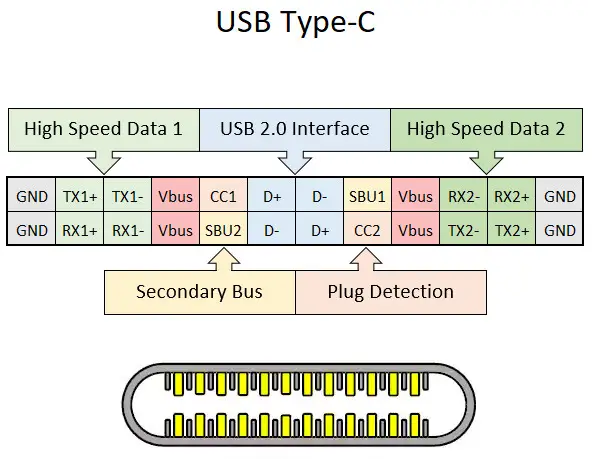

# 手机快充是是怎样实现的？
随着智能手机的高速发展，处理器的性能越来越强悍，在手机上游玩画质一流的大型游戏也不再是梦想。

但是，性能强悍的处理器虽然给我们带来了流畅的游戏体验，但是缺点也非常明显，那就是功耗也比较高，一般的手机游玩大型游戏4、5个小时就歇菜了，在电池技术尚未获得突破的今天，技术人员是如何曲线救国解决续航短板的问题的呢？没错，就是那句熟悉的台词。
>充电五分钟，通话两小时

这就是快充

## 快充的发展
我们都知道，P = U × I ，想要提高充电功率，可以提高电压或者电流。也就演变成了快充发展的三个大趋势：
>提高电压，高压快充方案；
加大电流，低压大电流方案；
我全都要 . jpg——电荷泵。

那么现在就让我们回顾一下最开始的快充技术是怎样的吧

----

2010年，为了提高USB-IF的充电功率，规范并提出了BC1.2充电协议，最高功率支持到7.5w，嗯，比苹果的5v1a快（

到了2012年7月，USB-IF发布了PD1.0快充协议，在当时提出了在USB3.0和USB2.0接口上传输最大100w的美好设想。可是受限于当时设备的兼容性和Micro-USB接口的信号不完整，最终没有实现，导致用户感知不强。

2013年，我们熟悉的高通发布了它的第一代快充协议，QC1.0，高通通过修改引脚，增加通信协议来识别快充，从而解决了新老设备的兼容性，使得电流达到Micro-USB接口的最大电流-2A，从而达到10w的功率，相比于传统的BC-1.2协议整整提升了40%。

2014年8月，USB-IF发布了两个具有革命性意义的产品，分别是PD2.0标准和Type-C接口，其中Type-C接口支持正反盲插，引脚数量大大提升，为未来的各种数据传输提供了足够的冗余。

而PD2.0协议充分利用了Type-C接口丰富的引脚，让它不仅能传输基本的电流和数据，还能输出音视频，而且速度还大大增加。做个比较，与Micro-USB相比，Type-C接口最大支持到20V5A即100w的功率，比垃圾Micro-USB不知道高到哪里去了。

2014年底，高通QC2.0发布。高通考虑到那时Type-C接口并未普及，市面上最多的接口是Micro-USB，高通的技术人员想到了一个在接口电流无法增加的情况下提升功率的方法，那就是提升输出电压，于是高通的QC2.0将充电器输出电压增加到了9V，最高支持到18W的功率。这就是前面提到的高压充电方案的雏形。

但是这种高压低流的充电方案也有着很明显的缺点，那就是手机发热大，因为手机电池无法直接接受来自充电器的9V电压，所以高压会在手机内部被降到适合锂电池的5V电压，而这个转换过程就会产生损耗，大概10%的功率会在损耗中变成热能，导致手机发热严重，几乎无法实现亮屏快充。

之后的QC3.0到QC4+快充协议，主要是朝着兼容性和安全性走的，成为了市面上普及率比较高的充电协议。

----

时间回到2017年左右，那是国内很多手机仍然还是垃圾的Micro-USB接口，传输电流的能力非常有限，但这可难不住我们的国产品牌-OPPO，OPPO通过魔改接口的方法在Micro-USB接口中增加了2个专门用来传输电力的引脚，让Micro-USB传统的5Pin接口变成了7Pin，大大的增加了接口的电流传输能力，最大可以传输4A电流。此后OPPO通过自己的VOOC快充协议在市面上宣传“充电五分钟，通话两小时”，在国内市场上掀起了一波高潮，让那时的人们认识到手机充电居然能这么快。

在此之后，联发科也推出了自己的快充协议-PEP，典型功率是12V 2A也就是24W，和高通的QC2.0快充一样，也是高压低流方案，通过加大电压来实现高功率充电。以及魅族早期的mCharge 1.0-4.0也就是基于联发科的PE协议，直到2016年底魅族和高通的和解，才兼容了主流的QC和PD快充协议。

----

在此之后，Type-C接口逐渐走进了大众，快充终于不用受限高压低流了，各个厂商都推出了自己的快充协议，如华为的SCP、FCP，OPPO的SuperVOOC、一加的Dash闪充、魅族的mCharge等等。

但是这么多的快充协议，导致的缺点也是很明显的，一个充电头只支持自己的协议，对支持的手机就能快充，不支持的话用户就只能忍受慢充的漫长充电时间了。于是在2017年2月，USB-IF组织更新了USB-PD3.0的标准，带来了可编程电源PPS，让一个充电设备支持多个充电协议，无论你是什么手机都能成功握手协议开始快充。PPS规范让充电设备的电压调幅细化到了20mV一档，电压调节更为精准。同时规定3A以上的数据线必须配备E-Marker芯片，简化传输协议、充电协议的握手程序，让握手更快，成功率更高。

上面讲了高压低流和低压高流，这两种方案都有各自的优缺点，比如低压高流对充电线要求比较高，需要购买专用的大电流数据线才能快充，那么如何兼顾低压和高压从、快充的优点呢？华为发布的SCP快充协议就完美的兼顾了上面两者的优点，SCP协议，采用10V4A电荷泵高压直冲技术，这个电荷泵是存在于手机里的降压部件，它能在损耗非常小的情况下将输入电压减半，将普通的90%转换率提高到了惊人的98%~99%左右，使得高压快充也不怎么发热。

同时，另一边的快充大厂OPPO也推出了自己的快充新技术，在手机内部做两块电芯，让两块电芯并联在一起，两块电芯同时充电，大大的提升了充电速度和充电效率。

之后各大手机厂商更是将充电功率提高到了100w甚至更高，使得手机充电不再有漫长的等待，起床后插入电源，洗脸刷牙吃个早餐的时间手机就充满了，简直不要太爽。

看完厉害的快充，让我们看一个熟悉的品牌，看看它对快充有什么特殊的见解吧。

# 苹果，快充发展中的一股泥石流

苹果我们最早知道的快充是Apple2.4A快充，苹果的Ipad赠送的充电器就支持这个快充协议，最大功率为12W，到了IPhone8之后便支持了PD快充协议，可是苹果和其他品牌不一样，它虽然支持快充，可是苹果不在手机包装附赠快充头，而一直都只给个5V1A的安全充电头（

并且官网上售卖的快充套装更是价格高得离谱，并且定价更是让人怀疑苹果公司的相关人员脑袋是不是让门夹了（

其中5W电源售价145￥，而20W电源售价149￥

？？？

而一根与之配套的USB-C转闪电数据线售价145￥，嗯，有钱人的钱真好赚（

并且第三方的配件想要支持苹果的快充就需要向苹果申请授权，那就是MFi认证，这个授权本意上是为了用户的充电安全，但极高的授权费用就一言难尽了。

# 快充究竟会不会伤害电池寿命呢？

这个问题不用说，肯定是会的，但其实不管是5W的安全快充还是100W的超级快充都是会减少电池寿命的，换句话说就是：人生这么短暂，让快充给你节约一点时间吧。手机是用来用的，不是用来当宝贝一样护着的，只要我们正常使用手机，都是没有关系的。

----

本文参考了多方资料，并经作者个人加入补充说明。
