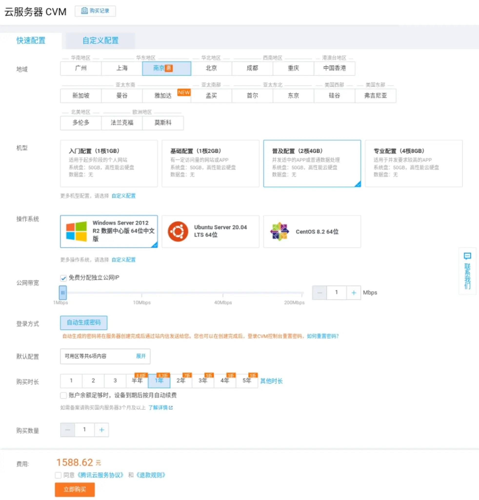

首先在教程之前我们需要准备**以下东西**
- 一个正常的、有足够判断能力、有耐心的人
- 有足够的经济支持
- 一台手机（如果有电脑那更好）

如果你准备好了，那么往下滑，教程正式开始。

## 1.什么是服务器？
Minecraft服务器（Minecraft Server）可以使玩家在线和其他玩家一起玩Minecraft。


### 服务器的种类
目前有多种服务器以独特的游戏内容、规则以及引入的社会结构而闻名。没有任何两个服务器是完全相同的，服务器类型之间的界线通常是模糊的无法区分的。许多特殊种类的服务器使用地图编辑器或在创造模式中来建造自定义地图，使用CraftBukkit软件来提供附加功能。这些服务器多数面向PVP，还有一些面向生存模式、创造模式和极限模式的，一些服务器拥有经济系统，一些服务器有内置迷你游戏。
那么，如何架设自己的我的世界服务器呢？让我们一起进入教程下一阶段。

## 2.如何架设服务器？
有许多工具提供给玩家以便玩家能够架设、运行和管理一个服务器。注意，服务器有服务器需求以便服务器能够高效流畅地运行。

官方多人游戏服务端可从Mojang处免费下载和使用，Windows、macOS以及基于Unix的系统（Linux、BSD...）可用。详见Minecraft多人游戏服务器教程以及Mojang的Minecraft 多人游戏服务器下载页面以获取帮助。
- **向局域网开放**提供一个在未在路由器设定转发的情况下与你同一本地网络的玩家可访问的服务器。详见搭建局域网服务器教程来获取更多信息。
- **第三方的服务端**如Bukkit、Spigot和Sponge为玩家提供一种向服务器添加插件的方法。这些服务端通常用在较大的服务器上，他们可以运行插件来防止恶意破坏、提供额外的玩法和获得比默认多人游戏服务端更强的多核性能。
- **租用服务器**是由其他公司外部托管的服务器。这些托管服务器并不是免费使用的，玩家必须定期支付服务器租金。
- **Realms**是Mojang官方托管服务器服务，允许一定数量的玩家在服务器游玩。

在此教程里，我们主要介绍如何租用服务器并在服务器上架设自己的我的世界服务器。

ps：这一句话可能有些绕，你需要弄懂租用的服务器和我的世界服务器之间的关系和区别，可以理解为租用的服务器就是一台电脑，在这台电脑上运行我的世界服务端，那么便把这个服务器叫做我的世界服务器。

此教程服务器提供商为**腾讯云**，当然你也可以选用其他的提供商，比如**阿里云**、**百度云**。

-------


### 如何租用服务器
打开服务器提供商官网，注册一个账号然后完成实名注册，详细的步骤就不说了，可以自己探索一下

在腾讯云官网中打开云服务器选购，即可看到如下画面。



可能有些小伙伴看到这个价格就有点害怕了，不用怕，其实图中所选配置适合中大型服务器，我们开一些小型生存服务器是不用这么多钱的，实测5人小型服务器只需1m带宽单核1g内存的服务器就能跑起来。

并且腾讯云有一个活动，可以用很便宜的价格购买一年的服务器，[点我即可打开](https://cloud.tencent.com/act/new?from=14034)


在活动中有一个99元一年的服务器，如果你只想开一个小型生存服务器，那么我推荐你购买这个。
ps：在服务器购买菜单中将系统选择为**Windows Server2016**记好服务器的IP地址和自己设的管理密码。

购买完毕后我们在**控制台**中就可以看到我们的服务器了。

请开放端口为 **UDP协议的19132** 端口，基岩版需要其进行通信(**列如阿里云、腾讯云需去安全组进行开放端口**)

------


### 在服务器上的具体操作

如果你使用的是手机，那么我们下载**RD Client**这个微软官方的远程管理软件，如果你使用的是电脑，那么我们可以按下win徽标搜索**远程桌面**即可。

进入软件，输入服务器IP、用户名以及密码，用户名默认是**Administrator**，输入完成进入远程桌面。

正常进入后，你会发现这不就是一台电脑吗？不管是壁纸、桌面上的软件都和我们平常看到的电脑一模一样，这就是我们前面说的**服务器就是一台电脑**。

我们打开服务器上的浏览器，如果没有就用IE下一个( IE太垃圾所以不把它看做是浏览器XD)。

打开[我的世界服务端官网](https://www.minecraft.net/en-us/download/server/bedrock/)，在里面选择下载适用于Windows的服务端文件，下载完成后解压到合适的地方，解压完成后我们会看到这些文件

- behavior_packs

- definitions

- resource_packs

- structures

- bedrock_server.exe

- bedrock_server.pdb

- bedrock_server_how_to.html

- permissions.json

- release-notes.txt

- server.properties

- whitelist.json

看到这么多文件，你可能会头疼“这么多文件，怎么弄？？“，不用担心，我们只需要对其中几个文件进行修改即可

## 配置

服务端解压后会包含一个名为`server.properties` 的配置文件，服务相关的配置就在这个配置文件中。

可以用 nano 编辑器打开配置文件编辑。

配置文件中的 `#` 开头的行是注释，可以不用管，主要就是修改 `=` 后面的内容。

下面是一些配置项说明：

- `gamemode`：默认的游戏模式，`survival` 生存，`creative` 创造，`adventure` 冒险。

- `difficulty`：默认难度，`peaceful` 和平，`easy` 简单，`normal` 普通，`hard` 困难。

- `max-players`：玩家数量限制，默认为 `10`。

- `server-port`：服务器端口，默认为 `19132`。

- `server-portv6`：IPv6 端口，默认为 `19133`。

- `online-mode`：正版验证，如果你的服务器可以正常连接到 Xbox Live 的话，可以设置为 `true`，否则可以设置为 `false`，即便不开启正版验证，客户端也需要登录 Xbox Live 才能联机。

- `white-list`：白名单，只有在白名单中的玩家才能进入服务器，默认为 `false`。

- `allow-cheats`：允许作弊，默认为 `false`。

- `player-idle-timeout`：自动踢出挂机玩家，默认为 30 分钟。

- `default-player-permission-level`：默认玩家等级，`visitor` 游客，`member` 普通玩家，`operator` 管理员。

## 白名单配置

服务端解压后会包含一个 `whitelist.json`文件，这就是储存白名单的文件，格式如下：

```json
[
    {
        "name": "name1",
        "ignoresPlayerLimit": "true"
    },
    {
        "name": "name2"
    }
]
```

其中的 `name` 是玩家的 Xbox 用户名，`ignoresPlayerLimit` 是忽略服务器人数限制，`ignoresPlayerLimit` 是可省略的。

只有 `server.properties` 配置文件中的 `white-list` 为 `true`，`whitelist.json` 中的白名单才会生效。

如果在服务器正在运行的时候修改了白名单的话，需要在服务器命令行中输入：

```text
whitelist reload
```

重新加载白名单才会生效。

设置了白名单后就只有 `whitelist.json` 中的玩家才能进入服务器。

-------

那么到了这一步，服务器的服务端调整就全部做完了，接下来需要做的就是双击启动**bedrock_server.exe**，伴随着美妙的命令的跳动，程序显示:

```text
[INFO] opening worlds/Bedrock level/db
[INFO] IPv4 supported, port: 19132
[INFO] IPv6 supported, port: 19133
[INFO] IPv4 supported, port: 62532
[INFO] IPv6 supported, port: 62533
[INFO] Server started.
```

我们需要记住第二行的“19132”，这是我们服务器的端口，在最后客户端连接服务器时需要输入。

------

接下来，打开你的客户端我的世界，输入服务器ip、端口，然后连接服务器，顺便叫上你的小伙伴们一起玩吧，Enjoy~
